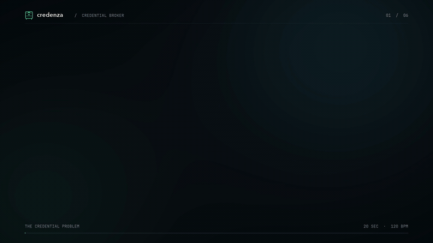

# credenza

A credential broker for LLM agents: an encrypted store, per-task temporary tokens, and a TLS-intercepting proxy that swaps each temporary token for the real secret on the way out, so the agent never sees a real credential. Go, standard library only, one static binary.

The name: a credenza was the cabinet where a servant tasted food for poison before it was served (from Latin *credere*, to trust).

Specification: [docs/spec.md](docs/spec.md).

Watch it work — 20 seconds: [docs/credenza-launch.mp4](docs/credenza-launch.mp4).

<p align="center">
  <a href="docs/credenza-launch.mp4">
    
  </a>
</p>

## Commands

Every subcommand takes `-dir <dir>` (default `/srv/credenza`). Flags go before positional arguments.

| Command | What it does |
|---|---|
| `credenza init` | create an empty encrypted store, `<dir>/store.enc`; asks for a new passphrase twice (at least 12 bytes) |
| `credenza secret add [-replace] <name>` | add a secret, or overwrite one with `-replace`; asks for the value without echo. With `serve` running it goes to the admin socket and is live at once (`saved; live`, no passphrase); otherwise it asks for the passphrase and writes the store (`used at next serve start`) |
| `credenza secret rm <name>` | remove a secret; live through the admin socket when `serve` runs, as for `add` |
| `credenza secret list` | print the secret names, never the values |
| `credenza ca init [-force] [-name <cn>] (-domains d1,d2 \| -unconstrained)` | create the credenza CA, name-constrained to the listed domains; `-name` sets its common name (default `credenza CA`); `-force` replaces an existing CA |
| `credenza ca-cert` | print the CA certificate (PEM) |
| `credenza passwd` | change the store passphrase |
| `credenza policy check` | validate `<dir>/policy.json` and print `policy ok: <n> project(s)` |
| `credenza serve [-listen :8888] [-max-session 24h] -clients <cidr,...>` | unlock the store and run the proxy and two control sockets, `<dir>/run/broker.sock` (`mint`, `renew`, `revoke` only) and `<dir>/run/admin.sock` (`secret-set`, `secret-rm`, `policy-load` only), both 0600; `-max-session` (1m to 720h) bounds how long `renew` can keep a task's tokens alive after its mint |
| `credenza ssh-command` | forced command of the session key: `mint <task-id> <project> [<env>...]` (env names narrow the mint to those grants, at most 3), `renew <task-id>` or `revoke <task-id>`, on `broker.sock` only |
| `credenza ssh-admin` | forced command of the policy key: `policy-load` with the policy on stdin (at most 256 KiB), on `admin.sock` only; `serve` validates it (format, secrets in the store, hosts inside the CA) and replaces `policy.json` atomically |
| `credenza version` | print the build version |

Errors are one line starting `credenza: ` on stderr. Admin commands exit 0 ok, 1 error, 2 usage; `mint`, `renew` and `revoke` also exit 3 when the broker is locked or not running and 4 when the policy denies the project (`renew` then revokes the task); `renew` exits 5 when the task has no live tokens or reached `-max-session`. `policy-load` exits 0 ok, 1 invalid (`credenza: invalid policy: <reason>`, old file kept) or failed (`write policy: ...`, old file kept; or `write audit log: ...`, new policy already in force), 2 usage, 3 locked or not running.

`renew` re-reads the policy and applies the task's current grants to its live tokens: each token gets its grant's rules and a new expiry, `min(now + ttl, mint + max-session)`; a token whose grant is gone is dropped. A request in flight, such as a long streamed response, ends when its token is revoked, dropped, changed by a renew (new rules or secret) or left to expire (within 5 seconds of the expiry), not at the expiry it had when the request started. One task id holds tokens of one project: a `mint` for another project while the task has live tokens exits 1.

## Test and build

```sh
go test -race ./...
sh scripts/build.sh
```

Tests run on macOS with `-race`. On Linux the race detector needs cgo and a C compiler; `TestHardenNotDumpable` runs only on Linux and passes without `-race`, for example in a rootless Podman `golang:1.27.3` container.

`scripts/build.sh` refuses a Go older than go1.27.3, builds static binaries (`CGO_ENABLED=0`) for linux/armv7, linux/arm64, linux/amd64, darwin/arm64, darwin/amd64 and freebsd/amd64 into `dist/credenza-<os>-<arch>`, and writes `dist/SHA256SUMS`.

## Docs

- [docs/user-manual.md](docs/user-manual.md): the user manual: what you can do with credenza, task by task, with a FAQ and a glossary.
- [docs/credenza-launch.mp4](docs/credenza-launch.mp4): the 20-second launch video (animated preview at the top of this page).
- [docs/spec.md](docs/spec.md): what credenza does and guarantees: tokens and leases, control and data planes, store, audit log, security model.
- [docs/policy.md](docs/policy.md): the policy file format, when changes apply, the lease (`ttl`), path matching and how to widen a rule.
- [docs/runbook.md](docs/runbook.md): the reference deployment on a Raspberry Pi: install, unlock after a reboot, smoke test, backup, upgrade and audit log rotation.
- [CHANGELOG.md](CHANGELOG.md).
- [SECURITY.md](SECURITY.md): how to report a vulnerability.

## License

Copyright (C) 2026 Daniel Aguayo.

Licensed under the Apache License, Version 2.0; see [LICENSE](LICENSE).
Unless required by applicable law or agreed to in writing, credenza is
distributed on an "AS IS" BASIS, WITHOUT WARRANTIES OR CONDITIONS OF ANY
KIND.
